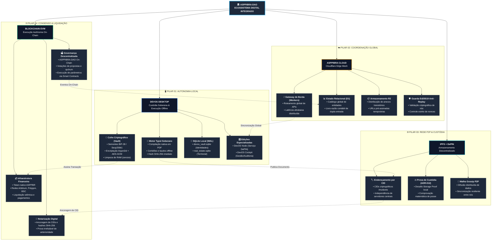

# DIGITAL WORLD ECOSYSTEM
### Arquitetura Soberana • Infraestrutura DePIN • Governança Descentralizada

Bem-vindo ao **DIGITAL WORLD ECOSYSTEM**, ecossistema tecnológico integrado da **ASPPIBRA-DAO** projetado para assegurar autonomia local, coordenação global, custódia descentralizada e liquidação em blockchain.

---

## 🏛️ Diagrama Arquitetural Oficial — Os 4 Pilares do Ecossistema

---

## 🧩 Detalhamento dos 4 Pilares e suas Derivações

### 🖥️ PILAR 01: DEVOS DESKTOP — Autonomia Local & Custódia Soberana
> *Ambiente nativo para execução offline, custódia e emissão probatória.*

* **Cofre Criptográfico de Chaves (Zero-Trust Local):**
  * Derivação hierárquica determinística BIP-39/BIP-44 (`m/44'/60'/0'/0/x` para EVM e Ed25519 para a rede).
  * Encriptação local em repouso com **Argon2id + AES-256-GCM**.
  * Limpeza estrita de memória RAM após uso (`zeroize`). As chaves privadas **nunca** deixam o dispositivo.
* **Motor de Documentação Soberana (Typst Engine):**
  * Compilação local, nativa e determinística de relatórios periciais e certidões imobiliárias em PDF.
  * Cálculo instantâneo do hash **SHA-256** do documento gerado para vinculação à blockchain.
* **Persistência Relacional Segregada (SQLite WAL):**
  * `devos_vault.sqlite`: Cofre de credenciais, identidades e configurações críticas locais.
  * `real_estate.sqlite`: Base cadastral territorial e registros geoespaciais.
* **Edições Especializadas:**
  * **DevOS Node:** Execução em segundo plano para provimento de nós DePIN, rotinas e serviços de rede.
  * **DevOS Cockpit:** Interface gráfica para governança executiva, auditoria territorial e assinatura de lotes.

---

### ☁️ PILAR 02: ASPPIBRA CLOUD — Coordenação Global & Serviços de Borda
> *Malha de borda global serverless para roteamento e catálogo institucional.*

* **Gateway Distribuído de Borda (Cloudflare Workers / Hono):**
  * Roteamento de APIs em escala global com latência ultrabaixa e alta resiliência.
* **Registro de Estado e Livro-Razão (Cloudflare D1):**
  * Catálogo de entidades públicas, dispositivos e metadados institucionais.
  * Livro-razão contábil de dupla entrada (`financial_ledger_entries`) auditável.
* **Armazenamento Seguro de Anexos (Cloudflare R2):**
  * Distribuição transitória de objetos via URLs pré-assinadas com expiração programada.
* **Guarda de Dispositivos & Anti-Replay (`devosDeviceGuard`):**
  * Validação criptográfica de assinaturas Ed25519 enviadas pelos nós Desktop, com verificação de *nonces* atômicos para proteção contra repetição.

---

### 🌐 PILAR 03: IPFS + DePIN — Rede P2P & Custódia Verificável
> *Camada descentralizada de armazenamento para documentos e metadados imutáveis.*

* **Endereçamento Imutável por Conteúdo (CIDs):**
  * Arquivos identificados univocamente por seu conteúdo criptográfico, livres de censura ou pontos únicos de falha.
* **Prova de Armazenamento Local (Desafio ADR-012):**
  * Protocolo criptográfico onde os nós DePIN comprovam matematicamente a posse íntegra dos dados sem precisar retransmitir arquivos inteiros.
* **Malha Gossip P2P:**
  * Difusão distribuída de dados e comunicação resiliente entre nós da rede.

---

### ⛓️ PILAR 04: BLOCKCHAIN EVM — Execução, Consenso & Liquidação On-Chain
> *Camada de regras de consenso, liquidação financeira irrevogável e fé pública matemática.*

* **Infraestrutura Financeira & Token ASPPBR:**
  * Padrão ERC-20 em redes EVM de alta eficiência (Arbitrum, Polygon POS, BSC).
  * Liquidação atômica e transferências financeiras sem intermediários bancários centrais.
* **Governança Descentralizada (ASPPIBRA-DAO):**
  * Ciclo integral de governança on-chain: propostas, quórum qualificado, votação auditável e execução programática.
* **Notarização Digital & Prova de Anterioridade:**
  * Ancoragem definitiva de CIDs e hashes SHA-256 em contratos inteligentes, garantindo eficácia jurídica e rastreabilidade perene.

---

## 🔄 Matriz de Integração entre as Camadas

| Origem ➔ Destino | Operação Técnica Realizada |
|---|---|
| **DevOS ➔ IPFS** | Publica documento gerado pelo Typst via RPC local (`127.0.0.1:5001`) e obtém o CID. |
| **DevOS ➔ Blockchain** | Assina transações de transferência ou governança localmente no cofre via Secp256k1. |
| **IPFS ➔ Blockchain** | Contratos inteligentes gravam o CID como prova de existência e integridade do ativo. |
| **Blockchain ➔ Cloud** | Workers indexam recibos, eventos e confirmações on-chain no banco relacional D1. |
| **Blockchain ➔ DevOS** | DevOS consulta RPCs multi-chain para atualizar saldos nativos e tokens ASPPBR em tempo real. |
| **Cloud ➔ DevOS** | Distribui estado global consolidado para visualização no DevOS Cockpit. |

---

## 🔐 Princípios Inegociáveis de Segurança

1. **Custódia Soberana Absoluta:** Chaves privadas nunca são enviadas para a nuvem; residem exclusivamente no cofre local do usuário.
2. **Imutabilidade Operacional:** Toda alteração crítica requer consenso em blockchain ou validação de dupla entrada contábil.
3. **Privacidade por Projeto:** Processamento sensível e geração documental ocorrem de ponta a ponta em ambiente offline.

---

  © DIGITAL WORLD ECOSYSTEM • ASPPIBRA-DAO • Todos os direitos reservados

